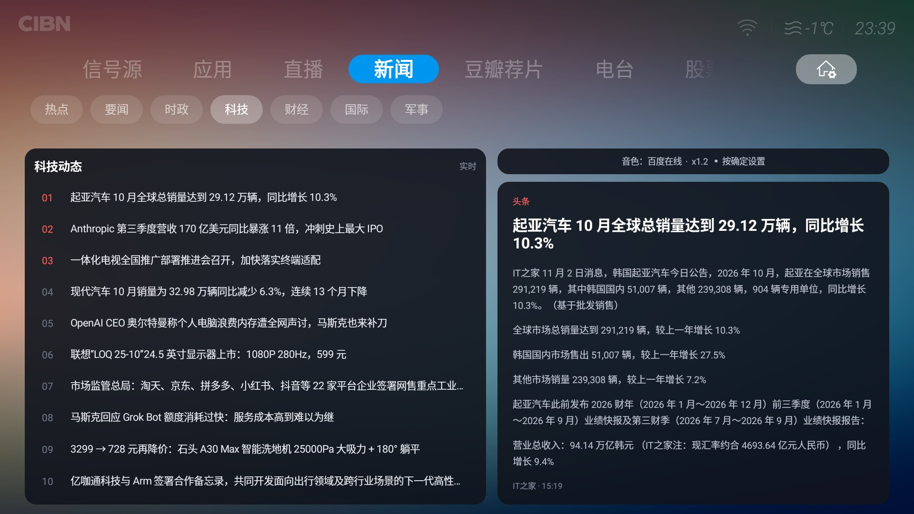
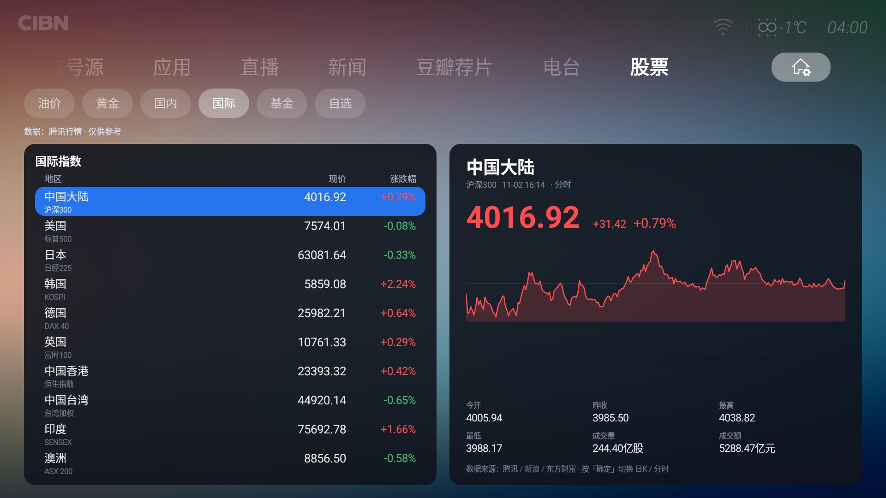

# 乐视超级电视 X3-55 桌面插件

> 不重做 Launcher，只在乐视原生桌面上增加自己想要的 **Tab**：新闻、直播、豆瓣荐片、电台、股票。
>
> 新闻和股票另外提供**独立 APK**：装完从应用列表直接启动，不依赖桌面 Tab。


**文档**：[架构](docs/ARCHITECTURE.md) · [刷机恢复](docs/RESTORE.md) · [真机实测记录](docs/DEVICE.md) · [独立应用](docs/STANDALONE.md) · [语音桥](docs/edge-tts.md) · [变更记录](CHANGELOG.md)

## 这是什么

乐视（Letv）超级电视的原生桌面 `com.stv.launcher` 有一套**插件机制**：插件 APK 不放桌面图标，而是被桌面当作「一个 Tab 页」加载，直接显示在顶部 Tab 栏里。（别人都在做减法，而我却在做加法）

本项目就是按这套机制写的五个插件，外加部署 / 恢复工具：

| 模块 | 包名 | 说明 |
|---|---|---|
| 新闻 | `com.dsh.tvdesk.news` | 7 个分类的纯文字新闻 + 语音朗读 |
| 直播 | `com.dsh.tvdesk.live` | 预览画面 + 频道墙，读 DIYP 格式频道表 |
| 豆瓣荐片 | `com.dsh.tvdesk.douban` | 豆瓣海报墙，点击交给 TVBox 搜索播放 |
| 电台 | `com.dsh.tvdesk.radio` | 15 个电台，5 个分类，底部播放条可遥控操作 |
| 股票 | `com.dsh.tvdesk.stock` | 油价 / 黄金 / 国内指数 / 国际大盘 / 基金 / 自选 |

### 独立应用（新闻 / 股票）

新闻和股票也能打成两个**普通 APK**，装完在电视的应用列表里直接启动，不需要 `com.stv.launcher` 的插件机制：

| 应用 | 包名 | 源码 | 产物 |
|---|---|---|---|
| 新闻 | `com.dsh.tvdesk.news.app` | `app-news/` | `news-app.apk` |
| 股票 | `com.dsh.tvdesk.stock.app` | `app-stock/` | `stock-app.apk` |

- 页面代码和插件版共用（`plugin-news/src`、`plugin-stock/src`），只是把宿主从桌面 Tab 换成 `app-host/` 里的 `HostActivity`
- 独立版没有插件的 `meta-data`，不会出现在桌面 Tab 栏
- 没有桌面 Tab 条，顶部留白从 96/100dp 收到 22dp；返回键退到分类条后再按一次退出
- 语音设置存在应用自己的 `SharedPreferences`；自选股、油价缓存仍在 `/sdcard/tvdesk/`，和插件版共用

实现细节和构建说明见 [docs/STANDALONE.md](docs/STANDALONE.md)。

## 功能一览

### 新闻



- **7 个分类**：热点 / 要闻 / 时政 / 科技 / 财经 / 国际 / 军事
- **纯文字**：左栏标题列表，右栏抓取文章原页正文（去掉广告、导航、"听全文"等杂质）
- **语音朗读**：连播标题，或在右栏按确定朗读全文；朗读设置里可切「引擎（百度在线 / 微软 Edge）· 音色 · 语速（0.8/1.0/1.2/1.5）」，改完立刻用新参数重播
- **自动续播**：一条全文读完停 3 秒，期间没按任何键就自动接下一条的全文；状态栏显示倒计时，按任意键取消
- **微软语音**：电视自己连微软会被 TLS 指纹拦（403），所以走局域网 OpenWrt 上的 edge-tts 桥服务（`http://<路由器>:8123/tts`），语速通过 `rate` 参数传给 edge；部署步骤见 [docs/edge-tts.md](docs/edge-tts.md)，脚本在 [tools/tts-edge](tools/tts-edge)
- **按键**：上下移动、右键进详情、详情页上下滚动；左键先在列表里回到第一条，再按一次才回分类条；返回分两级退出

### 直播


- 读 `/sdcard/DIYP影音/*.txt`（DIYP 格式，`#` 开头为分组；每个文件一组，按 央视 / 地方 / 数字 / 吉林 排序）
- IJK 播放器 + 低延迟参数（`overlay-format=fcc-rv32`、大缓冲）
- 台名自动清理（去掉「高清」「超高清」「现网」等后缀）
- 预览画面 + 2×5 频道墙

### 豆瓣荐片


- 热播电影 / 热播剧集 / 热播综艺 / 国产剧 / 美剧 / 韩剧 / 日剧 / 动画电影 / 国漫 / 日漫 / 纪录片 / 高分
- 海报网格 + 详情，点播交给 TVBox（需安装 `com.github.tvbox.osc.tk`）

### 电台


- 分类：新闻广播、音乐电台、财经电台、少儿故事、全部电台
- 默认首个为「中国之声」
- 底部播放条可用遥控器聚焦操作

### 股票

国际分栏，默认近一年日 K：


详情区按「确定」切当日分时：



六个分栏，遥控器左右切换：

| 分栏 | 内容 |
|---|---|
| 油价 | 31 省 92#/95#/98#/0# 柴油表格；柴油四标号推算；下次调价与预计调整（元/升）；近一年调价曲线；默认吉林，分类条按确定可刷新 |
| 黄金 | 黄金9999 / 沪金2612 / COMEX 黄金 / COMEX 白银；近一年日 K 曲线 |
| 国内 | 上证、深证、沪深300、中证500、中证1000、上证50、创业板、科创50；默认近一年日 K，详情区按确定切当日分时 |
| 国际 | 中国大陆、美国、日本、韩国、德国、英国、中国香港、中国台湾、印度、澳洲；和国内同一套排版，默认近一年日 K，可切分时；成交量统一按「亿股」，成交额按本币「亿」 |
| 基金 | 独立列表，净值 + 日涨幅，可添加/删除 |
| 自选 | A 股 / 港股 / 美股 / 日股，可添加/删除；默认近一年日 K，可切分时 |

> 副标题里的更新时间统一按**北京时间**显示：美股行情源给的是美东时间，插件里已自动换算（含夏令时）；日本等市场休市时就是上一个交易日的时间。

交互约定：

- 左列表带表头：油价是「省份 / 92# / 95# / 98# / 0#柴油」，其余分栏是「名称 / 现价 / 涨跌幅」（国际是「地区」，国内是「指数」，基金是「基金 / 单位净值 / 日涨幅」）
- 左右两栏宽度 1:1（左栏原来 1.1，油价 5 列仍放得下）
- 列表末尾「＋ 添加股票 / ＋ 添加基金」，选中后按「确定」输入代码
- 选中任意一项按「菜单」键删除
- 分类条上按「确定」= 刷新当前分类
- 左侧列表按「左/右」进入右侧详情区（详情区描一圈白边）；详情区按「确定」= 近一年日 K ⇄ 当日分时，再按一次切回
- 在详情区按「左」回当前行；列表按「左」回第一行、按「上」回分类条

油价不是实时行情（发改委 10 个工作日才调一次价），所以单独做了缓存：

- 抓一次存 12 小时，缓存落在 `/sdcard/tvdesk/oil.cache`（调价表在 `oil.adjusts`，6 小时）
- 切 TAB、切分栏、再切回来都不会重新抓；状态栏显示「油价 HH:mm 取过（本地缓存）」
- 只有按「确定」手动刷新才会重抓；抓不到的省沿用上次的值，不会把整张表刷成 `--`
- 插件被桌面重新加载时静态变量会丢，所以缓存必须落盘——只放内存等于没有

## 数据来源

| 用途 | 接口 |
|---|---|
| A 股 / 港股 / 美股 / 日股行情 | 腾讯 `qt.gtimg.cn` |
| 国际指数（日经、DAX、KOSPI、ASX、SENSEX、台湾加权、富时100） | 新浪 `hq.sinajs.cn`（`znb_` 前缀） |
| 国际指数日 K / 缺失的今开最高最低 | 东方财富 `push2his`（`100.N225` 等 secid） |
| 国际指数成交量 / 成交额 | 东方财富 `push2/ulist.np/get`（一次批量取 10 个 secid） |
| 省份油价 | `qiyoujiage.com` 各省页面 |
| 调价历史 | `soyoujia.cn/tiaojia` |
| 黄金 / 期货 | 东方财富 `push2` / `push2his` |
| 基金净值 | 天天基金 `fundmobapi.eastmoney.com` |

> 所有数据仅供个人查看，不构成投资建议。

## 安装

插件放在：

```
/data/data/com.stv.launcher/files/plugins/<name>.apk
```

并在 `launcher_new.db` 的 `SCREEN_INFO` 表登记（`NAME / PACKAGE_NAME / VERSION_CODE / SHOW_ON_TAB / SCREEN_ORDER / PLUGIN_PATH / MD5 / FILE_SIZE`）。

最省事的方式是用 `release/` 里的 `launcher_new.db` 直接覆盖（已含 5 个插件的登记），再执行 `restore.sh`。

### 安装独立应用

独立版就是普通 APK，直接装即可（和插件版可以同时存在）：

```bash
adb install -r release/news-app.apk
adb install -r release/stock-app.apk
```

### 刷机后快速恢复

电视刷完机、什么都没了，按下面四步把五个 Tab 装回来：

**第一步：下载恢复包**

打开 [Releases 页面](https://github.com/113073010/tv-desktop/releases/latest)，下载最新的 `tv-desktop-vX.X.X-restore.zip`，解压到电脑上。

**第二步：把文件推到电视上**

```bash
adb push 解压目录/ /data/local/tmp/tvrestore
```

**第三步：在电视上执行恢复脚本**

```bash
adb shell su -c 'sh /data/local/tmp/tvrestore/restore.sh'
```

脚本会自动把 5 个 APK 装到桌面插件目录、覆盖数据库、并重启桌面。

**第四步：等电视重启完**

回到电视桌面，顶部 Tab 栏应该能看到新闻、直播、豆瓣、电台、股票五个新 Tab。

> 如果脚本提示数据库和 APK 校验不一致，先在 PC 上跑一次 `.\scripts\sync-db.ps1`
> （或 `python release/check-db.py --fix`），再把 `release/` 重新 push 上去；也可以加 `--force` 强制执行。
>
> 直播频道表需要自己放到 `/sdcard/DIYP影音/*.txt`（DIYP 格式，`#` 开头是分组），脚本不带频道源。

换过 APK 之后，先在 PC 上跑一次：

```powershell
.\scripts\sync-db.ps1
```

它会把 `SCREEN_INFO` 里的 `FILE_SIZE` / `MD5` 与新 APK 对齐并重建 `SHA256SUMS.txt`；
（装了 Python 的话 `python release/check-db.py --fix` 效果相同，还会顺手对齐版本号）。
`restore.sh` 也会在覆盖前检查，不一致就拒绝执行（除非加 `--force`）。

详细安装教程放在 [docs/RESTORE.md](docs/RESTORE.md)，真机实测记录放在 [docs/DEVICE.md](docs/DEVICE.md)，
文档索引见 [docs/README.md](docs/README.md)。

## 实测环境

在 Letv X3-55 上验证：

| 项 | 值 |
|---|---|
| 系统 | Android 5.0.1（SDK 21） |
| 固件 | `V2301RCN02C060072B08221N` |
| 桌面 | `com.stv.launcher` 1.0.2（versionCode 20170509） |
| 屏幕 | 1920×1080 / density 240 |
| 播放内核 | TVBox `com.github.tvbox.osc.tk` |

## 目录结构

```
build.ps1              统一构建入口：-Target news|live|douban|radio|stock|news-app|stock-app|all -Release
scripts/
  build-plugin.ps1     插件构建流水线（5 个插件共用）
  build-app.ps1        独立应用构建流水线（2 个应用共用）
  bump-version.ps1     改 versionName / versionCode
  sync-db.ps1          把 release APK 的 MD5 / 大小写回 launcher_new.db
  pack-restore.ps1     打恢复包 zip
shared/plugin-sdk/
  plugin/              编译期桩：桌面 launcher SDK + support-v4（不进 dex）
  app/                 独立应用运行时垫片：Fragment / BaseFragment / ActivityActionHandler
plugin-news/           新闻插件源码（AndroidManifest.xml + src + test + build.ps1 包装）
plugin-live/           直播插件源码（额外打包 ijk 播放器）
plugin-douban/         豆瓣荐片插件源码
plugin-radio/          电台插件源码
plugin-stock/          股票插件源码
app-news/              新闻独立应用（Activity + res + build.ps1 包装）
app-stock/             股票独立应用
app-host/              独立应用宿主层 HostActivity
signing/               签名 keystore（*.jks 不入库，首次构建自动生成）
release/               签名 APK + 数据库模板 + 电视端部署脚本 + SHA256SUMS（扁平，整包可 push）
docs/                  逆向笔记与运维文档，索引见 docs/README.md
```

## 构建

只装 JDK 17 和 Android build-tools 34 就能跑；不需要 Gradle。

```powershell
.\build.ps1                      # 五个插件 + 两个独立应用
.\build.ps1 -Target news         # 只构建新闻插件
.\build.ps1 -Target news-app     # 只构建新闻独立应用
.\build.ps1 -Target all -Release # 全部构建并复制到 release/
```

流水线：

```
javac（编译 shared/plugin-sdk 的桩）→ javac → d8 → aapt2 link → 塞入 dex → zipalign → apksigner
```

独立应用多一步 `aapt2 compile`（图标 / banner）。产物在各自 `build/` 下，模块目录里的
`build.ps1` 只是转发到 `scripts/` 的薄包装，可以继续单独调用。

工具链查找顺序：`$env:TVTOOLS` → 仓库及其各级上级目录下的 `tools/`（需含 `android-sdk` 和 `jdk`）。

### 改完代码之后

```powershell
.\scripts\bump-version.ps1 -Target news   # 版本号 +1（也可 -Version / -Code 指定）
.\build.ps1 -Target news -Release         # 构建并复制到 release/
.\scripts\sync-db.ps1                     # 同步 launcher_new.db 的 MD5 / FILE_SIZE + 重建 SHA256SUMS
```

> `sync-db.ps1` 需要 `sqlite3.exe`，默认在 `tools/platform-tools/` 下找；没装 Python 也能用。
> 已装 Python 的话 `python release/check-db.py --fix` 效果相同。

签名统一用 `signing/tvdesk.jks`（同一个 keystore，插件和独立应用共用）；文件不入库，
第一次构建时自动生成，换机器构建会得到不同签名——覆盖安装会报签名不一致。

## 插件机制要点

- 插件是普通 APK，放在 launcher 的 `files/plugins/` 下，由 launcher 用 DexClassLoader 加载
- manifest 中声明 `meta-data`：`ILePluginCreateApi`（CreateApi 全类名）、`minDependentVersion`、`widgetName`
- `dependentPackages="com.stv.launcher.sdk;android.support.v4"`，launcher 提供这两个包；仓库里
  `shared/plugin-sdk/plugin/` 是它们的**编译期桩**，只用来过 javac，不会打进 dex
- 写入新 APK 后必须**同步更新 `SCREEN_INFO` 里的 `MD5` 和 `FILE_SIZE`**，否则 launcher 认为没变化，继续用旧 dex
- 替换 APK 前要 `kill -9` launcher 进程，否则系统会立即拉起旧进程并持有旧文件

分层、加载链路和发版流程见 [docs/ARCHITECTURE.md](docs/ARCHITECTURE.md)。

## 已知问题

- 基金、国际的走势曲线在部分网络环境下取不到历史数据（接口连通性问题），其余分类正常

## License

MIT
