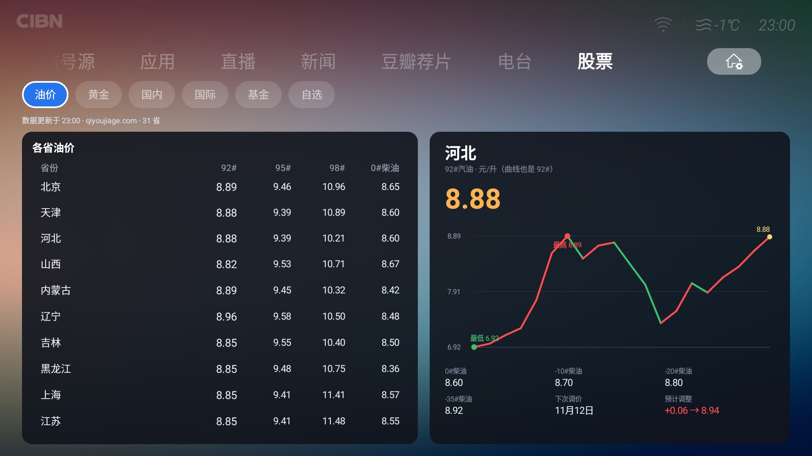
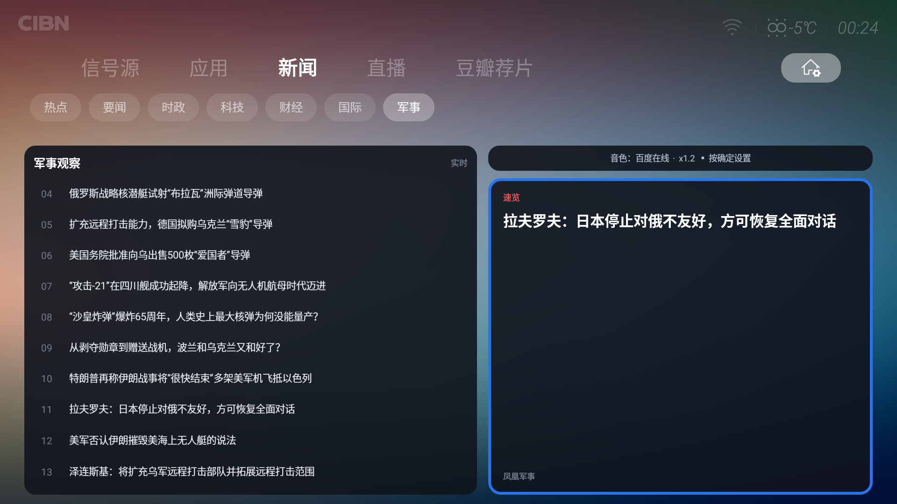
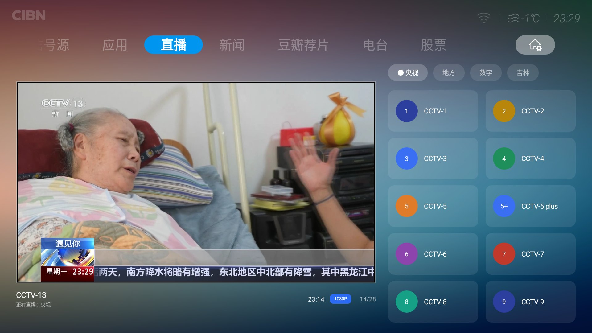
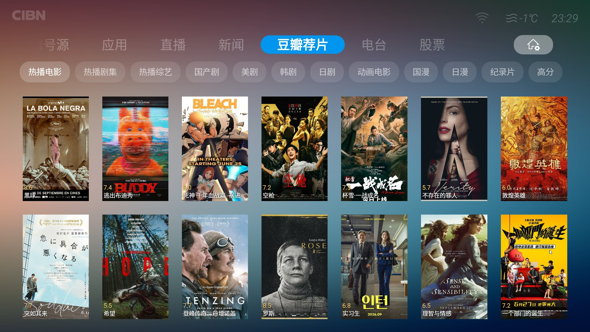
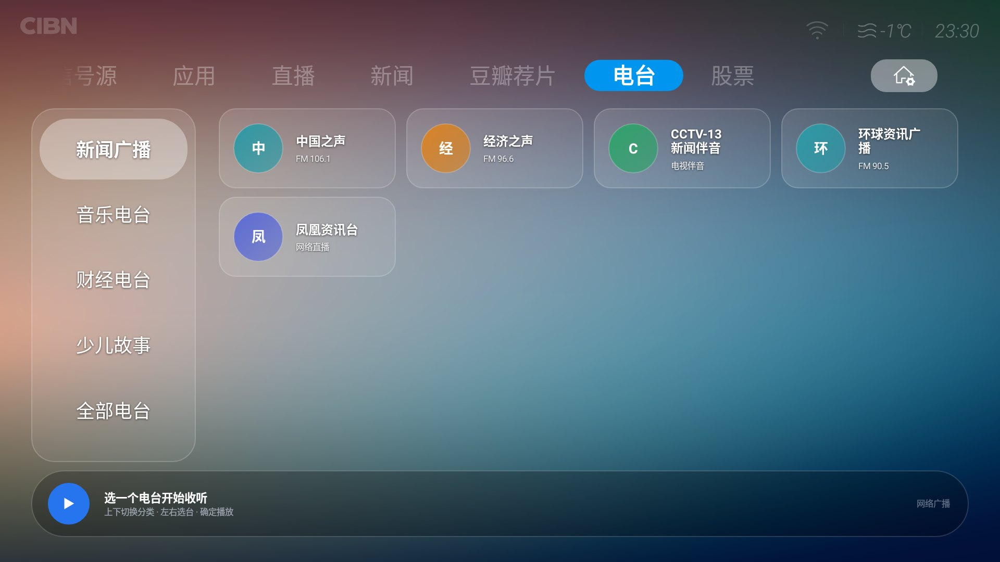

# 乐视超级电视 X3-55 桌面插件五件套

> 不重做 Launcher，只在乐视原生桌面上增加自己想要的 **Tab**：新闻、直播、豆瓣荐片、电台、股票。



## 这是什么

乐视（Letv）超级电视的原生桌面 `com.stv.launcher` 有一套**插件机制**：插件 APK 不放桌面图标，而是被桌面当作「一个 Tab 页」加载，直接显示在顶部 Tab 栏里。

本项目就是按这套机制写的五个插件，外加部署 / 恢复工具：

| 模块 | 包名 | 说明 |
|---|---|---|
| 新闻 | `com.dsh.tvdesk.news` | 7 个分类的纯文字新闻 + 语音朗读 |
| 直播 | `com.dsh.tvdesk.live` | 预览画面 + 频道墙，读 DIYP 格式频道表 |
| 豆瓣荐片 | `com.dsh.tvdesk.douban` | 豆瓣海报墙，点击交给 TVBox 搜索播放 |
| 电台 | `com.dsh.tvdesk.radio` | 15 个电台，5 个分类，底部播放条可遥控操作 |
| 股票 | `com.dsh.tvdesk.stock` | 油价 / 黄金 / 国内指数 / 国际大盘 / 基金 / 自选 |

## 功能一览

### 新闻



- **7 个分类**：热点 / 要闻 / 时政 / 科技 / 财经 / 国际 / 军事
- **纯文字**：左栏标题列表，右栏抓取文章原页正文（去掉广告、导航、"听全文"等杂质）
- **语音朗读**：连播标题，或在右栏按确定朗读全文；语速可调（0.8/1.0/1.2/1.5）
- **按键**：上下移动、右键进详情、详情页上下滚动、返回分两级退出

### 直播



- 读 `/sdcard/tvdesk/直播源.txt`（DIYP 格式，`#` 开头为分组）
- IJK 播放器 + 低延迟参数（`overlay-format=fcc-rv32`、大缓冲）
- 台名自动清理（去掉「高清」「超高清」「现网」等后缀）
- 预览画面 + 2×5 频道墙

### 豆瓣荐片



- 热播电影 / 热播剧集 / 热播综艺 / 国产剧 / 美剧 / 韩剧 / 日剧 / 动画电影 / 国漫 / 日漫 / 纪录片 / 高分
- 海报网格 + 详情，点播交给 TVBox

### 电台



- 分类：新闻广播、音乐电台、财经电台、少儿故事、全部电台
- 默认首个为「中国之声」
- 底部播放条可用遥控器聚焦操作

### 股票


六个分栏，遥控器左右切换：

| 分栏 | 内容 |
|---|---|
| 油价 | 31 省 92#/95#/98#/0# 柴油表格；柴油四标号推算；下次调价与预计调整（元/升）；近一年调价曲线；默认吉林，分类条按确定可刷新 |
| 黄金 | 黄金9999 / 沪金2612 / COMEX 黄金 / COMEX 白银；近一年日 K 曲线 |
| 国内 | 上证、深证、沪深300、中证500、中证1000、上证50、创业板、科创50；当日分时 |
| 国际 | 中国大陆、美国、日本、韩国、德国、英国、中国香港、中国台湾、印度、澳洲（地区名 + 大盘名） |
| 基金 | 独立列表，净值 + 日涨幅，可添加/删除 |
| 自选 | A 股 / 港股 / 美股 / 日股，可添加/删除 |

交互约定：

- 列表末尾「＋ 添加股票 / ＋ 添加基金」，选中后按「确定」输入代码
- 选中任意一项按「菜单」键删除
- 分类条上按「确定」= 刷新当前分类

## 数据来源

| 用途 | 接口 |
|---|---|
| A 股 / 港股 / 美股 / 日股行情 | 腾讯 `qt.gtimg.cn` |
| 国际指数（日经、DAX、KOSPI、ASX、STI、NIFTY、台湾加权） | 新浪 `hq.sinajs.cn`（`int_` / `znb_` 前缀） |
| 省份油价 | `qiyoujiage.com` 各省页面 |
| 调价历史 | `soyoujia.cn/tiaojia` |
| 黄金 / 期货 | 东方财富 `push2` / `push2his` |
| 基金净值 | 天天基金 `fundmobapi.eastmoney.com` |

> 所有数据仅供个人查看，不构成投资建议。

## 安装

插件放在：

```
/data/data/com.stv.launcher/files/plugins/<name>.apk
```

并在 `launcher_new.db` 的 `SCREEN_INFO` 表登记（`NAME / PACKAGE_NAME / VERSION_CODE / SHOW_ON_TAB / SCREEN_ORDER / PLUGIN_PATH / MD5 / FILE_SIZE`）。

最省事的方式是用 `release/` 里的 `launcher_new.db` 直接覆盖（已含 5 个插件的登记），再执行 `restore.sh`。

## 目录结构

```
plugin-news/     新闻插件源码（AndroidManifest.xml + src + stubs + build.ps1）
plugin-live/     直播插件源码
plugin-douban/   豆瓣荐片插件源码
plugin-radio/    电台插件源码
plugin-stock/    股票插件源码
release/         签名后的 APK、数据库模板、部署脚本
docs/            逆向笔记（插件机制、踩坑）
```

## 构建

每个插件目录下都有 `build.ps1`，流程：

```
javac → d8 → aapt2 link → 塞入 dex → zipalign → apksigner
```

需要 JDK 17 + Android build-tools 34。

## 插件机制要点

- 插件是普通 APK，放在 launcher 的 `files/plugins/` 下，由 launcher 用 DexClassLoader 加载
- manifest 中声明 `meta-data`：`ILePluginCreateApi`（CreateApi 全类名）、`minDependentVersion`、`widgetName`
- `dependentPackages="com.stv.launcher.sdk;android.support.v4"`，launcher 提供这两个包的 stub
- 写入新 APK 后必须**同步更新 `SCREEN_INFO` 里的 `MD5` 和 `FILE_SIZE`**，否则 launcher 认为没变化，继续用旧 dex
- 替换 APK 前要 `kill -9` launcher 进程，否则系统会立即拉起旧进程并持有旧文件

## 已知问题

- 基金、国际的走势曲线在部分网络环境下取不到历史数据（接口连通性问题），其余分类正常

## License

MIT
