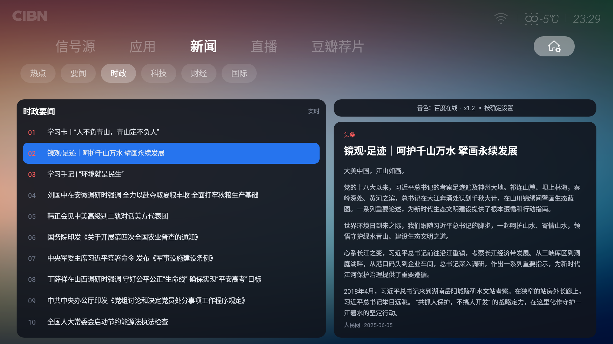

# 乐视超级电视 X3-55 桌面插件三件套

> 不重做 Launcher，只在乐视原生桌面上增加三个自己想要的 **Tab**：新闻、直播、豆瓣荐片。



## 这是什么

乐视（Letv）超级电视的原生桌面 `com.stv.launcher` 有一套**插件机制**：插件 APK 不放桌面图标，
而是被桌面当作「一个 Tab 页」加载，直接显示在顶部 Tab 栏里（信号源 / 应用 / 新闻 / 直播 / 豆瓣荐片）。

本项目就是按这套机制写的三个插件，外加一个**一键恢复工具**：

| 模块 | 包名 | 说明 |
|---|---|---|
| 新闻 | `com.dsh.tvdesk.news` | 7 个分类的纯文字新闻 + 语音朗读 |
| 直播 | `com.dsh.tvdesk.live` | 预览画面 + 2×5 频道墙，读 DIYP 格式频道表 |
| 豆瓣荐片 | `com.dsh.tvdesk.douban` | 豆瓣海报墙，点击交给 TVBox 搜索播放 |

## 功能一览

### 新闻


- **7 个分类**：热点 / 要闻 / 时政 / 科技 / 财经 / 国际 / 军事
- **纯文字**：左栏标题列表，右栏抓取文章原页正文（去掉广告、导航、"听全文"等杂质）
- **语音朗读**：连播标题，或在右栏按确定朗读全文；语速可调（0.8/1.0/1.2/1.5）
- **按键**：上下移动、右键进详情、详情页上下滚动、返回分两级退出

### 直播

- 顶部预览画面 + 下方 2×5 频道墙
- 频道表读 `/sdcard/DIYP影音/*.txt`（DIYP 格式），自动分类：央视 / 地方 / 数字 / 吉林
- 默认频道：名称含「新闻」或「CCTV-13」
- 4K 频道会标注并给出提示

### 豆瓣荐片

- 12 个分类（热播电影/剧集/综艺、国产剧、美剧、韩剧、日剧、动画、国漫、日漫、纪录片、高分 Top250）
- 7×2 海报墙，横向滚动分页，默认 250 条高分片单
- 点击海报 → 唤醒 TVBox 并触发搜索

## 怎么用（Agent / 命令行）

刷机、换机、或者只是想让别的 Agent 帮你装回来 —— **不需要编译**，`release/` 目录里就是全部所需文件。

### 方式 A：命令行（Agent 最容易执行）

```bash
# 1) 连接电视（IP 换成实际地址）
adb connect 192.168.1.10:5555
adb devices

# 2) 确认 root（电视上可能弹 SuperSU，点「授权」）
adb shell su -c id            # 期望：uid=0(root) gid=0(root)

# 3) 把 release 目录推到电视
adb push release /data/local/tmp/tvrestore

# 4) 执行恢复脚本
adb shell su -c 'sh /data/local/tmp/tvrestore/restore.sh'
```

脚本会打印每一步结果，并校验三个 APK 和数据库是否就位。
失败时返回具体错误码：`2` 缺文件、`3` 不是乐视桌面、`4` 插件复制失败、`5` 数据库替换失败。

**执行完验证**

```bash
adb shell su -c 'ls -l /data/data/com.stv.launcher/files/plugins/'
adb shell su -c 'ls -l /data/data/com.stv.launcher/databases/launcher_new.db'
```

期望：三个 APK 存在（权限 600，属主 system），数据库权限 660；桌面已自动重启，
顶部 Tab 栏出现 **新闻 / 直播 / 豆瓣荐片**。

### 直播自定义源

直播 TAB 的频道表就是几个 **纯文本文件**，放在电视的：

```
/sdcard/DIYP影音/*.txt
```

改这个目录里的 txt 就能换台，**不用改代码、不用重新打包**。改完在电视上退出直播页再进（或重启桌面）即生效。

#### 文件与分组

| 文件名 | 出现在哪个分类 |
|---|---|
| `央视.txt` | 央视 |
| `地方.txt` | 地方 |
| `数字.txt` | 数字 |
| `吉林.txt` | 吉林 |
| 其他任意名 `.txt` | 追加在最后（按文件名排序） |

分类顺序固定为 央视 → 地方 → 数字 → 吉林 → 其他（文件名以这四个词开头也会归入对应分类）。
某个文件不存在或解析为空，就没有那个分类。

#### 每行格式

```text
频道名,播放地址
```

例如：

```text
CCTV-1综合,http://example.com/cctv1.m3u8
CCTV-13新闻,rtsp://10.0.0.1:554/live/cctv13
湖南卫视,http://example.com/hunan.m3u8
```

规则（按代码实际行为）：

| 规则 | 说明 |
|---|---|
| 分隔符 | **英文逗号** `,`（中文逗号不认） |
| 忽略行 | 空行、以 `#` 开头的注释行 |
| 支持的协议 | `http` / `https` / `rtsp` / `rtmp` / `udp` / `igmp` |
| URL 后缀 | `#` 或 `$` 之后的内容会被截掉（DIYP 的 `$` 分隔写法也能用） |
| 编码 | UTF-8 或 GBK 都行（程序先试 UTF-8，失败退回 GBK） |
| 排序 | 按文件内出现顺序 |

#### 怎么替换

**方式一：U 盘/电脑改**

```bash
# 从电视拉下来
adb pull /sdcard/DIYP影音/央视.txt

# 改完推回去（或直接推一个新文件覆盖）
adb push 央视.txt /sdcard/DIYP影音/
```

**方式二：直接写**

```bash
adb shell "cat > /sdcard/DIYP影音/我的源.txt" <<'EOF'
CCTV-1,http://example.com/cctv1.m3u8
CCTV-13,http://example.com/cctv13.m3u8
EOF
```

**方式三：恢复工具自动写入**

仓库 `release/` 里没有频道表，恢复后按上面的格式自己写，或从备份目录拷贝，
可以先用它铺底，再自己改。

#### 默认播放哪个台

进入直播页时自动播当前分类里 **名称含「新闻」或「CCTV-13」** 的频道；
没有匹配就播该分类第一个。

#### 常见问题

| 现象 | 原因 |
|---|---|
| 分类没出现 | 文件名不对（大小写/扩展名），或者文件里没有一条合法行 |
| 有分类但列表空 | 每行缺英文逗号，或 URL 协议不在支持列表里 |
| 中文名乱码 | 文件存成了 GB2312 之外的编码，另存为 UTF-8 或 GBK |
| 频道黑屏 | 源本身失效；rtsp 源需要 TVBox 的 IJK 内核，没有 TVBox 播不了 |
| 改了没生效 | 退出直播页再进；仍不行就 `am force-stop com.stv.launcher` 后重开 |
### 彻底卸载（clear.sh）

要把这三个 TAB 从电视上**卸干净**（不留残留），执行：

```bash
adb push release /data/local/tmp/tvrestore
adb shell su -c 'sh /data/local/tmp/tvrestore/clear.sh'
```

清掉的东西：

| 类别 | 具体位置 |
|---|---|
| 插件 APK | `files/plugins/{news,live,douban}.apk` |
| 插件数据 | `plugins_data/com.dsh.tvdesk.*` |
| 插件偏好 | `shared_prefs/tvdesk_news.xml` 等 |
| 插件缓存 | `cache/ijkdex`、`cache/tts*.mp3` |
| 调试副本 | `/sdcard/plugin_dev/` |
| 调试日志 | `/sdcard/tvdesk.log` |
| 桌面 TAB 记录 | 用 `release/launcher_clean.db` 替换（三条记录已删除） |

加 `--all` 连频道表和备份一起删：

```bash
adb shell su -c 'sh /data/local/tmp/tvrestore/clear.sh --all'
```

```
/sdcard/DIYP影音/                    ← 频道表
/sdcard/launcher_new.before_*.db     ← 恢复/清除前后的数据库备份
```

脚本最后会做**残留检查**，逐项确认插件、数据、偏好、日志是否清干净，
并报告频道表是保留还是已删除。

清除前会自动备份当前数据库到 `/sdcard/launcher_new.before_clear.db`，
想反悔就用 `restore.sh` 覆盖回去。

清完后桌面只剩 **信号源 / 应用**。

### release/ 里有什么

| 文件 | 说明 |
|---|---|
| `news.apk` / `live.apk` / `douban.apk` | 三个插件（v50 / v24 / v46） |
| `launcher_new.db` | 已登记三个 TAB 的桌面数据库 |
| `restore.sh` | 设备端恢复脚本（幂等，自动备份原库到 `/sdcard/launcher_new.before_restore.db`） |
| `clear.sh` | 彻底卸载脚本（插件 + 数据 + 偏好 + 缓存 + 日志 + TAB 记录，加 `--all` 连频道表一起删） |
| `launcher_clean.db` | 清除用的数据库（三个 TAB 记录已删除） |
| `restore.bat` | Windows 双击运行（改里面的 `TV=` 为你的电视 IP） |
| `SHA256SUMS.txt` | 校验和 |

### 关于 TVBox

直播 TAB 的播放内核借用 TVBox（`com.github.tvbox.osc.tk`）。
`release/` **不包含** TVBox（避免二次分发第三方应用）：

- 已装 TVBox → 直接按上面步骤恢复，一切正常
- 没装 → 恢复照样成功，但 rtsp / 4K 频道播不了（HLS / HTTP 可用）

详细排查、回滚方法见 **[docs/RESTORE.md](docs/RESTORE.md)**。
## 快速开始

### 前提

- 乐视电视（本项目在 **Letv X3-55 / Android 5.0.1 / MStar monaco** 上验证）
- 电视已 **root**（插件安装需要写 `/data/data/com.stv.launcher/`）
- 直播功能需要 **TVBox**（借用它的 IJK 播放内核）

### 安装方式一览

| 方式 | 适合场景 | 命令 |
|---|---|---|
| **命令行** | Agent / 有 adb 环境 | `adb push release /data/local/tmp/tvrestore` 后跑 `restore.sh` |
| **Windows 脚本** | 双击省事 | `release/restore.bat` |
| **手动** | 完全掌控 | 见下方说明 |

**手动安装**：把 APK 放进 `/data/data/com.stv.launcher/files/plugins/`，
并往 `launcher_new.db` 的 `SCREEN_INFO` 表插入对应记录

### 编译

每个插件目录下有独立的 `build.ps1`，依赖：

- **JDK 17**：设置环境变量 `JAVA_HOME`，或放到 `<repo>\tools\jdk\`
- **Android SDK**：需要 build-tools 34 与 `platforms/android-34/android.jar`，
  设置环境变量 `ANDROID_SDK_ROOT`，或放到 `<repo>\tools\android-sdk\`
- Launcher SDK 的桩代码（各目录 `stubs/`，已随仓库提供）
- 签名密钥：脚本首次运行会自动生成 `build\tvdesk.jks`（仅调试用）

```powershell
$env:JAVA_HOME = "C:\Program Files\Java\jdk-17"
$env:ANDROID_SDK_ROOT = "C:\Android\sdk"
cd plugin-news
.\build.ps1
```

```powershell
cd plugin-news
.\build.ps1     # 产出 build\news.apk
```

编译链：`javac → d8 → aapt2 link → 塞入 dex → zipalign → apksigner`

## 原理要点

### 插件是怎么被桌面认出来的

`AndroidManifest.xml` 里的 meta-data：

```xml
<meta-data android:name="ILePluginCreateApi" android:value="com.dsh.tvdesk.news.CreateApi" />
<meta-data android:name="minDependentVersion" android:value="1.0.0" />
<meta-data android:name="widgetName" android:value="新闻" />
<meta-data android:name="dependentPackages" android:value="com.stv.launcher.sdk;android.support.v4" />
```

`dependentPackages` 必须声明，否则桌面报 `start failed by newInstance error`。

插件入口实现 `ILePluginCreateApi`，返回一个继承 `BaseFragment` 的 Fragment；
桌面的 `SCREEN_INFO` 表通过 `TAG / PACKAGE_NAME / VERSION_CODE / SHOW_ON_TAB` 决定是否显示这个 Tab。

> `VERSION_CODE` 必须和 APK 的 `versionCode` 一致，否则桌面不会重新加载插件。

### 数据源

| 分类 | 来源 |
|---|---|
| 热点 | 腾讯新闻热榜 `r.inews.qq.com`（JSON） |
| 要闻 | 中新网 要闻导读 RSS |
| 时政 | 中新网 国内 RSS |
| 科技 | IT之家 RSS |
| 财经 | 中新网 财经 RSS |
| 国际 | 中新网 国际 RSS |
| 军事 | 凤凰网军事（网页抓取，无 RSS） |

全部为公开接口，无需密钥。

> 人民网 `politics/it/finance` 三个 RSS 已停更于 2025-06，故弃用。

### Android 5 的坑

- 系统根证书过旧，访问 https 常报 `Trust anchor for certification path not found` → 插件内使用宽松 `X509TrustManager`
- `MediaPlayer` 无法直接播放 https 音频流 → 先下载到缓存目录再本地播放
- `AssetManager` 不认 assets 子目录 → 恢复工具的资源全部平铺在 assets 根目录
- `su -c` 传多行脚本会失败 → 先写文件再 `sh 文件`

## 逆向笔记（这个插件机制是怎么找到的）

网上没有任何关于乐视桌面插件开发的中文资料，这部分完全靠对设备上 `com.stv.launcher` 的逆向。
把过程记下来，方便后来人少走弯路。

### 1. 定位桌面

```bash
adb shell pm list packages | grep launcher
# package:com.stv.launcher

adb shell dumpsys package com.stv.launcher | grep -i "plugin\|sdk"
```

### 2. 找到插件的存放方式

```bash
adb shell su -c 'ls -l /data/data/com.stv.launcher/files/plugins/'
```

里面躺着两个系统自带插件（`com.stv.plugin.app.apk`、`com.stv.plugin.tvlive.apk`），
说明**插件不是独立安装的 App，而是被桌面当作嵌套 dex 加载的 APK**。

### 3. 反查插件的契约

把自带插件拉下来解包，看 `AndroidManifest.xml`：

```bash
adb pull /data/data/com.stv.launcher/files/plugins/com.stv.plugin.app.apk
aapt2 dump badging com.stv.plugin.app.apk
aapt2 dump xmltree --file AndroidManifest.xml com.stv.plugin.app.apk
```

关键就是这几个 meta-data：

| 键 | 含义 | 示例值 |
|---|---|---|
| `ILePluginCreateApi` | 插件入口类（实现 `ILePluginCreateApi`） | `com.dsh.tvdesk.news.CreateApi` |
| `widgetName` | 显示在 Tab 上的名字 | `新闻` |
| `minDependentVersion` | 要求桌面 SDK 的最低版本 | `1.0.0` |
| `dependentPackages` | 依赖的包（**必须声明**） | `com.stv.launcher.sdk;android.support.v4` |

### 4. 桌面数据库

```bash
adb shell su -c 'sqlite3 /data/data/com.stv.launcher/databases/launcher_new.db \
  "select TAG,NAME,PACKAGE_NAME,VERSION_CODE,SHOW_ON_TAB,SCREEN_ORDER from SCREEN_INFO"'
```

`SCREEN_INFO` 每行 = 一个 Tab：

| 字段 | 作用 |
|---|---|
| `TAG` / `NAME` | Tab 标识与显示名 |
| `PACKAGE_NAME` | 插件包名 |
| `VERSION_CODE` | **必须与 APK 的 versionCode 一致**，否则桌面不重载插件 |
| `SHOW_ON_TAB` | 1 = 显示在 Tab 栏；0 = 收进「桌面管理 → 待添加」 |
| `SCREEN_ORDER` | Tab 顺序 |
| `PLUGIN_STATE` | `available` 才会加载 |

### 5. 第一次跑起来踩的坑

| 报错 / 现象 | 原因 | 解法 |
|---|---|---|
| `start failed by newInstance error` | 缺 `dependentPackages` | 补上 `com.stv.launcher.sdk;android.support.v4` |
| 插件不加载、Tab 空白 | 数据库 `VERSION_CODE` 与 APK 不一致 | 两边同步改 |
| 改完没生效 | 桌面缓存旧 APK | `am force-stop com.stv.launcher` 后重开 |
| Tab 自己消失 | 开了 `plugin_dev_mode`，启动时重扫并重置 `showOnTab` | 保持该开关为 `false` |
| `minDependentVersion` 解析失败 | 版本号超过 3 段（如 `1.0.0.0`） | 只用 3 段：`1.0.0` |
| 插件数据写到哪 | 桌面进程内运行，`getCacheDir()` 指向桌面的 cache | 见 `plugins_data/<包名>` |

### 6. SDK 桩代码

真实 SDK 拿不到，按插件 APK 的调用点还原出 4 个桩类即可编译：

```
com/stv/launcher/sdk/fragment/BaseFragment.java
com/stv/launcher/sdk/plugin/ActivityActionHandler.java
com/stv/launcher/sdk/plugin/api/ILePluginCreateApi.java
android/support/v4/app/Fragment.java
```

桩只需要“能被编译”，运行时用的是桌面里真实的类 —— 这也是为什么插件 APK 里**不能**打包这些类。

## 已知限制

- 仅在一台 X3-55 上验证，其他机型/固件可能不兼容（尤其桌面数据库结构）
- 凤凰军事的正文在 JS 里渲染，部分文章右栏可能抓不到全文
- 4K 频道依赖 TVBox 的 IJK 内核；没有 TVBox 时回退系统播放器，rtsp 多路会失败
- 朗读使用百度在线合成，机械感较强；未找到可用的免密钥男声方案

## 目录结构

```
plugin-news/      新闻插件（源码 + 构建脚本 + SDK 桩）
plugin-live/      直播插件
plugin-douban/    豆瓣荐片插件
docs/images/      截图
tools-install_tab.sh  调试用：替换插件并重启桌面
```

## 关键词

方便搜索引擎与 GitHub 检索命中（也是本仓库涉及的技术点）：

```
ILePluginCreateApi
dependentPackages
minDependentVersion
widgetName
com.stv.launcher
launcher_new.db
SCREEN_INFO
SHOW_ON_TAB
VERSION_CODE
SCREEN_ORDER
PLUGIN_STATE
plugins_data
plugin_dev_mode
乐视 桌面 插件
乐视电视 自定义 TAB
Letv launcher plugin
Android TV launcher plugin
reverse engineering
```

## 许可

代码以 MIT 许可发布，详见 [LICENSE](LICENSE)。

注意事项：

- 本项目**不包含** TVBox、豆瓣、各新闻站点的任何二进制或内容
- 抓取的新闻内容版权归原站点所有，仅供个人阅读使用
- 随意刷机有风险，root 与修改系统数据库请自行承担后果
